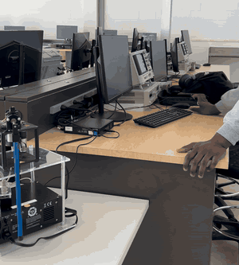
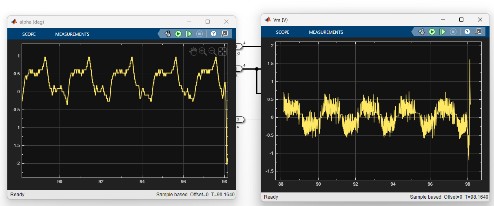
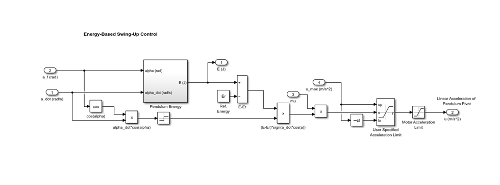

# Pendule inversé rotatif — commande par retour d'état et swing-up

Projet de fin de session du cours **GEN1743 – Commande numérique** (UQO, hiver 2026), réalisé en équipe de 2 avec **Ariel Toussaint Bekobo Nguedi**, sur le banc **Quanser SRV02 + ROTPEN**.

L'objectif : amener un pendule de sa position pendante jusqu'à la verticale (swing-up), puis le maintenir en équilibre avec un contrôleur par retour d'état, d'abord en simulation MATLAB/Simulink, puis sur le système réel.

 <em>Sur le banc réel : le pendule part de la position pendante, se redresse (swing-up) puis reste en équilibre. Accéléré 1,5×. <a href="swingup_extrait.mp4">Extrait vidéo</a></em>

## Résultats

| | Spécification | Mesuré |
|---|---|---|
| Déviation max. du pendule \|α\| | < 15° | **8,5°** |
| Tension max. du moteur \|Vm\| | < 10 V | **3,7 V** |
| Pôles en boucle fermée | ζ = 0,7, ωn = 4 rad/s | −2,8 ± 2,856j, −30, −40 |
| Gain de retour d'état K | — | [−5,26 ; 28,16 ; −2,76 ; 3,22] |

- Le pendule se redresse seul depuis la position pendante, puis le contrôleur de balance prend le relais automatiquement lorsque |α| < 12°.
- En équilibre, il suit une consigne de ±20° sur le bras rotatif.
- Les résultats sur le banc réel concordent avec la simulation.

## Démarche

1. **Modélisation** : équations du mouvement par Euler-Lagrange, linéarisation autour de la verticale, modèle d'état 4×4 (θ, α, θ̇, α̇) incluant la dynamique du moteur. En boucle ouverte, le système a un pôle instable.
2. **Contrôlabilité** : la matrice de contrôlabilité est de rang 4, donc tous les pôles peuvent être placés.
3. **Placement de pôles** : passage par la forme compagne (matrice de transformation W), calcul de K, puis vérification avec `place()` de MATLAB.
4. **Calibration du banc** : vérification des conventions de signe et des encodeurs.
5. **Swing-up** : contrôleur non linéaire basé sur l'énergie (Er ≈ 0,42 J, μ = 6, u_max = 10 m/s²) avec commutation automatique vers le contrôleur de balance.
6. **Analyse** : scripts MATLAB pour tracer les réponses et calculer la déviation et la tension max. et RMS.

## Contenu du dépôt

| Fichier | Contenu |
|---|---|
| `ROTPEN_ABCD_eqns_student.m` | Modèle d'état (A, B, C, D), pôles en boucle ouverte, contrôlabilité |
| `d_pole_placement_student.m` | Placement de pôles par forme compagne, calcul de K |
| `calcul_poles.m` | Vérification des pôles et du gain avec `place()` |
| `trace_reponse_bras_et_tension_moteur.m` | Tracés θ, α, Vm et indicateurs max/RMS |
| `deviation_p.m` | Déviation max. du pendule et tension max. |
| `q_rotpen_*_student.mdl` | Modèles Simulink : modélisation, balance et swing-up |
| `Rapport_Pendule_Inverse_Rotatif.pdf` | Rapport complet (39 pages) |
| `Presentation_Pendule_Inverse_Rotatif.pdf` | Diapositives de la présentation |
| `swingup.gif`, `swingup_extrait.mp4` | GIF et extrait vidéo des essais |

> Les scripts de configuration fournis par Quanser (`setup_rotpen.m`, `config_srv02.m`, `config_sp.m`, etc.) ne sont pas inclus : ils sont distribués avec le matériel de laboratoire Quanser. Pour exécuter le projet, lancez `setup_rotpen.m` de Quanser, qui appelle les scripts de ce dépôt.

## Outils

MATLAB · Simulink · QUARC (temps réel) · Quanser SRV02 / ROTPEN

## Équipe

- **Durrice Lea Tahoc Wokam** — étudiante en génie informatique, UQO · [Portfolio](https://anonymouscandela.github.io) · [LinkedIn](https://www.linkedin.com/in/durriceleatahocwokam)
- **Ariel Toussaint Bekobo Nguedi**
# Pendule inversé rotatif — commande par retour d'état et swing-up

Projet de fin de session du cours **GEN1743 – Commande numérique** (UQO, hiver 2026), réalisé en équipe de 2 avec **Ariel Toussaint Bekobo Nguedi**, sur le banc **Quanser SRV02 + ROTPEN**.

L'objectif : amener un pendule de sa position pendante jusqu'à la verticale (swing-up), puis le maintenir en équilibre avec un contrôleur par retour d'état, d'abord en simulation MATLAB/Simulink, puis sur le système réel.

 <em>Sur le banc réel : le pendule part de la position pendante, se redresse (swing-up) puis reste en équilibre. Accéléré 1,5×. <a href="images/swingup_extrait.mp4">Extrait vidéo</a></em>

## Résultats

| | Spécification | Mesuré |
|---|---|---|
| Déviation max. du pendule \|α\| | < 15° | **8,5°** |
| Tension max. du moteur \|Vm\| | < 10 V | **3,7 V** |
| Pôles en boucle fermée | ζ = 0,7, ωn = 4 rad/s | −2,8 ± 2,856j, −30, −40 |
| Gain de retour d'état K | — | [−5,26 ; 28,16 ; −2,76 ; 3,22] |

- Le pendule se redresse seul depuis la position pendante, puis le contrôleur de balance prend le relais automatiquement lorsque |α| < 12°.
- En équilibre, il suit une consigne de ±20° sur le bras rotatif.
- Les résultats sur le banc réel concordent avec la simulation.

## Démarche

1. **Modélisation** : équations du mouvement par Euler-Lagrange, linéarisation autour de la verticale, modèle d'état 4×4 (θ, α, θ̇, α̇) incluant la dynamique du moteur. En boucle ouverte, le système a un pôle instable.
2. **Contrôlabilité** : la matrice de contrôlabilité est de rang 4, donc tous les pôles peuvent être placés.
3. **Placement de pôles** : passage par la forme compagne (matrice de transformation W), calcul de K, puis vérification avec `place()` de MATLAB.
4. **Calibration du banc** : vérification des conventions de signe et des encodeurs.
5. **Swing-up** : contrôleur non linéaire basé sur l'énergie (Er ≈ 0,42 J, μ = 6, u_max = 10 m/s²) avec commutation automatique vers le contrôleur de balance.
6. **Analyse** : scripts MATLAB pour tracer les réponses et calculer la déviation et la tension max. et RMS.

## Contenu du dépôt

| Dossier | Contenu |
|---|---|
| `matlab/ROTPEN_ABCD_eqns_student.m` | Modèle d'état (A, B, C, D), pôles en boucle ouverte, contrôlabilité |
| `matlab/d_pole_placement_student.m` | Placement de pôles par forme compagne, calcul de K |
| `matlab/calcul_poles.m` | Vérification des pôles et du gain avec `place()` |
| `matlab/trace_reponse_bras_et_tension_moteur.m` | Tracés θ, α, Vm et indicateurs max/RMS |
| `matlab/deviation_p.m` | Déviation max. du pendule et tension max. |
| `simulink/` | Modèles Simulink : modélisation, balance et swing-up |
| `docs/Rapport_Pendule_Inverse_Rotatif.pdf` | Rapport complet (39 pages) |
| `docs/Presentation_Pendule_Inverse_Rotatif.pdf` | Diapositives de la présentation |
| `images/` | GIF et extrait vidéo des essais, figures |

> Les scripts de configuration fournis par Quanser (`setup_rotpen.m`, `config_srv02.m`, `config_sp.m`, etc.) ne sont pas inclus : ils sont distribués avec le matériel de laboratoire Quanser. Pour exécuter le projet, lancez `setup_rotpen.m` de Quanser, qui appelle les scripts de ce dépôt.

## Outils

MATLAB · Simulink · QUARC (temps réel) · Quanser SRV02 / ROTPEN

## Équipe

- **Durrice Lea Tahoc Wokam** — étudiante en génie informatique, UQO · [Portfolio](https://anonymouscandela.github.io) · [LinkedIn](https://www.linkedin.com/in/durriceleatahocwokam)
- **Ariel Toussaint Bekobo Nguedi**
